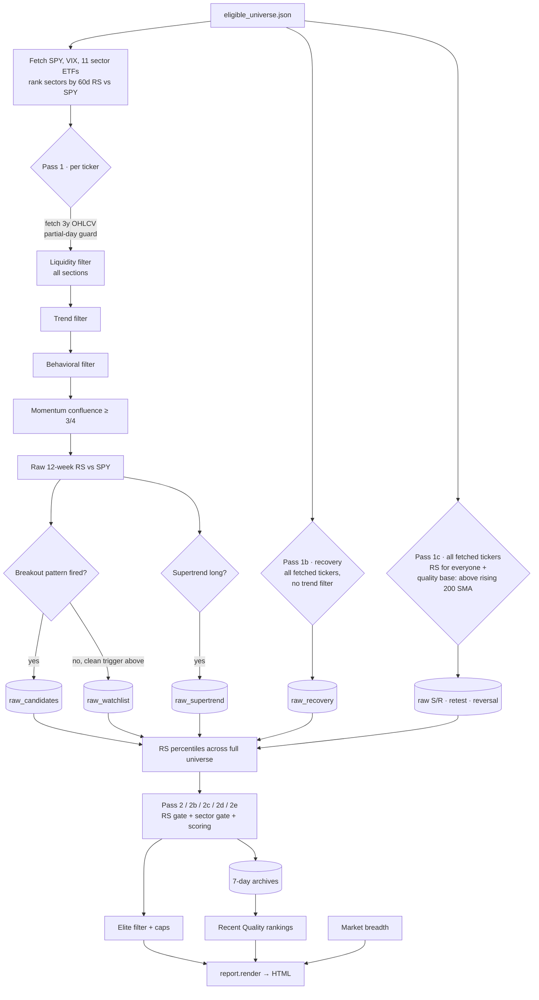

# Architecture

How the Breakout Swing Tool is put together: what runs, in what order, where state
lives, and where to change things. For setup and day-to-day use see `README.md`;
for the quarterly universe refresh see `SCREENING.md`.

---

## 1. Purpose and design principles

A daily, fully automated screen of a hand-curated US equity universe that surfaces a
small number of high-confluence swing-trade candidates (trend + momentum + volume +
relative strength + sector tailwind), published as a static HTML report.

| Principle | What it means in practice |
|---|---|
| Zero cost | GitHub Actions + GitHub Pages + `yfinance`. No paid APIs, no secrets. |
| Standalone | Independent of the weekly Positional Trading Tool. Shares only the Supertrend parameters (ATR 10 × 2.5) so both read the same signal. |
| Manual universe, automated scan | You curate ~500 tickers quarterly; the machine does everything daily. |
| Curated output | Strict "elite" filter and hard caps keep each daily section to 5–8 names. Everything that passes base gates is still archived. |
| State in git | All persistent state is committed JSON. No database. Daily commits also keep the workflow from being auto-disabled for inactivity. |
| Tunable in one place | Every threshold is a named constant at the top of `daily_scan.py`. |

---

## 2. Repository layout

```
breakout-swing-tool/
├── .github/workflows/daily-scan.yml   CI schedule and steps
├── input/manual_universe.csv          Your quarterly screen export (Ticker + Sector)
├── build_universe.py                  CSV → eligible_universe.json
├── daily_scan.py                      Orchestrator: fetch, filter, score, archive, render
├── patterns.py                        Pure indicator / pattern functions (no I/O)
├── report.py                          Pure HTML rendering (no I/O except write helpers)
├── eligible_universe.json             Generated each run from the CSV (committed)
├── data/                              Persistent state (committed by CI)
│   ├── report_history.json            Per-ticker appearance dates (14 d) + breadth history
│   ├── signals_archive.json           Breakout signals, rolling 7 d
│   ├── watchlist_archive.json         Watchlist entries, rolling 7 d
│   ├── supertrend_archive.json        Supertrend-long entries, rolling 7 d
│   ├── recovery_archive.json          Recovery entries, rolling 7 d
│   ├── setups_archive.json            S/R, retest, holding, reversal, MTF RSI, positional; rolling 7 d
│   └── fundamentals_cache.json        Yahoo fundamentals per ticker, refreshed weekly
├── reports/YYYY-MM-DD.html            One report per run (committed)
├── index.html                         Copy of the latest report (GitHub Pages landing)
├── requirements.txt                   pandas, numpy, requests, yfinance==0.2.65
├── README.md / SCREENING.md / ARCHITECTURE.md
```

**Module boundaries.** `patterns.py` and `report.py` are pure: they take DataFrames or
dicts and return values or HTML strings. All network access, file I/O, gating and
scoring policy live in `daily_scan.py`. Keep it that way: it makes indicators and
rendering testable without network access.

---

## 3. Runtime: the daily workflow

`.github/workflows/daily-scan.yml`, cron `0 22 * * 1-5` (22:00 UTC, Mon–Fri, after the
US close in both EST and EDT), plus manual `workflow_dispatch`. Timeout 30 min.

1. Checkout, set up Python 3.11, `pip install -r requirements.txt`
2. Fail fast if `input/manual_universe.csv` is missing
3. `python build_universe.py` → `eligible_universe.json`
4. `python daily_scan.py` → `reports/<date>.html`, updated `data/*.json`
5. Copy the newest `reports/*.html` to `index.html` (this overwrites the dashboard
   index that `daily_scan.py` also writes; the copy is what Pages serves)
6. Commit `eligible_universe.json reports/ data/ index.html` and push

Required repo settings: Actions → Workflow permissions → Read and write. Pages →
deploy from `main`, folder `/ (root)`.

---

## 4. Universe build (`build_universe.py`)

Reads the CSV with case-insensitive column aliases:

| Field | Accepted headers | Required |
|---|---|---|
| Ticker | `Ticker`, `Symbol` | Yes |
| Sector | `Sector`, `GICS Sector` | Strongly recommended |
| Name | `Name`, `Company`, `Company Name`, `Security Name` | No |

Normalises `BRK.B` → `BRK-B`, de-duplicates, drops malformed tickers, writes
`{"refreshed_at", "eligible": [{ticker, name, sector, piotroski_f_score}]}`.

**Sector matters.** Sector labels are mapped to SPDR ETFs via `SECTOR_TO_ETF` in
`daily_scan.py`. A ticker whose sector is missing or unmappable is never sector-gated
(rank `None` passes every sector check). If fewer than half the universe maps, the
scan logs `WARNING: only X/N tickers have a mappable sector`.

---

## 5. Scan pipeline (`daily_scan.py::main`)



### 5.1 Data fetch

`fetch_prices()` pulls 3 years of daily OHLCV per ticker (needed for monthly RSI)
with a 0.3 s delay. **Partial-day
guard:** if the last bar's volume is under 30% of the prior 20-day average, the bar is
dropped as an incomplete session (protects manual runs during market hours). Fetched
frames are cached in `price_cache` and reused by Pass 1b, Pass 1c and breadth.

**Liquidity levels.** `liquidity_profile()` stores, for every fetched ticker, a tier
(Very high ≥ $100M/day, High ≥ $25M, Adequate ≥ $10M), average shares/day, average
dollar volume and 1% of ADV. Before rendering, these are attached to every displayed
row (including weekly lists) and shown under the ticker.

**Liquidity filter (every section).** Right after fetching, `passes_liquidity()`
requires price ≥ $10, 20-session average volume ≥ 500K shares and average dollar
volume ≥ $10M. Failing tickers go into an `illiquid` set that Pass 1b and Pass 1c
also skip. Breadth still uses them, so breadth reflects the whole universe.

### 5.2 Pass 1: shared pre-filters (breakouts, watchlist, Supertrend)

| Gate | Rule | Constants |
|---|---|---|
| Trend | Close > SMA50 and > SMA200; SMA200 rising over 20 bars; within 25% of 52W high | `TREND_*` |
| Behavioral | No overnight gap-down worse than −10% in last 20 sessions | `BEHAVIORAL_MAX_GAP_DOWN_PCT` |
| Momentum | ≥ 3 of 4: RSI(14) 50–75; ADX(14) ≥ 20; weekly MACD(12,26,9) histogram > 0; 52W range position ≥ 60% | `MOMENTUM_*` |

Survivors get a raw RS value, then branch. **The branches are not exclusive**: a
ticker can land in Supertrend and in either breakouts or watchlist. Multi-section
appearances are intended confluence.

- **Breakout**: `patterns.scan_all_patterns()` fires any of 20/55/252-session high,
  horizontal resistance break, or volatility-contraction break (each with volume
  confirmation).
- **Watchlist**: no pattern fired, and `compute_watchlist_setup()` finds a pending
  trigger above price (20-day high, falling back to 55-day). Tickers already above
  both are skipped.
- **Supertrend**: `patterns.supertrend_state()` (ATR 10 × 2.5, Wilder ATR,
  TradingView band-carry logic) reports direction = long.

### 5.3 Pass 1b: Recovery (separate population)

Recovery candidates have just come out of a correction, so they usually fail the
"within 25% of 52W high" trend rule. Pass 1b therefore re-scans **every fetched
ticker**, skipping the trend filter:

1. Behavioral filter
2. `patterns.golden_cross_recovery()`: 20 EMA above 200 EMA, gap ≤ 10%, crossover
   from below within the last 30 bars, 20 EMA higher than 5 bars ago
3. Momentum ≥ 3/4 (same function as Pass 1)

### 5.3b Pass 1c: full-universe RS and the S/R, retest and reversal setups

Pass 1c first computes raw 12-week RS for **every** fetched ticker, so percentiles
rank against the whole universe. (Before this, only trend-filter survivors were
ranked, which made "RS ≥ 75" mean the top quarter of the strongest quarter.)

It then applies a shared **quality base** (behavioral filter, close above a 200 SMA
that is higher than 20 sessions ago) and collects three setup types:

- **Support / resistance**: `patterns.nearest_support_resistance()` clusters swing
  highs and lows (5 bars each side, last 120 sessions, 1.5% clustering, ≥ 2 touches)
  and keeps tickers within 3% of the nearest level above or below.
- **Recent breakout**: `patterns.recent_breakout_status()` finds a close above the
  prior 55-session high on ≥ 1.5× volume 1–20 sessions ago, then classifies it as
  `retest` (pulled back ≥ 3%, recent low within 2% of the level, still holding) or
  `holding`. Breakouts closing > 3% back below the level are dropped as failed.
- **Reversal swing**: `patterns.reversal_swing_setup()` requires a 5–25% pullback
  from the 20-day high, RSI(14) ≤ 40 within 5 sessions, and a bullish engulfing,
  outside-reversal or hammer candle today.
- **Multi-timeframe RSI**: `patterns.mtf_rsi_bounce()` requires monthly and weekly
  RSI(14) ≥ 60 and a daily RSI cross from below 50 within 3 sessions, with cross-day
  volume ≥ 1.0× average. Checked after the behavioral filter, before the 200 SMA
  quality base.

**Fake breakouts.** `recent_breakout_status()` now returns `failed` / `failing`
statuses instead of dropping them, plus `fake_flags` (weak breakout close, marginal
volume, no follow-through, heavy selling since, back below level) and
`resistance_touches` (swing highs at the level before the break).
`todays_breakout_risk()` flags same-day breakouts (weak close, marginal volume,
extended > 5%, gap-and-fade); an Adverse regime adds a flag after breadth is known.
Retest and holding rows lose 5 points per flag.

**Positional candidates.** Every quality-base member is also recorded with its
extension metrics (% above 200 SMA and 50 SMA, daily and weekly RSI). After Pass 1c,
`refresh_fundamentals()` fetches missing or stale entries (> 7 days; failed lookups
retry after 3 days) via `yf.Ticker(t).info`, at most 120 per run, into
`fundamentals_cache.json`. Pass 2f runs `evaluate_positional()`: hard gates for
financial quality (ROE ≥ 10%, positive margin and FCF, D/E ≤ 2×), fair valuation
(PEG ≤ 2, or forward P/E ≤ 30 without PEG) and not overextended (0–15% above the 200
SMA, ≤ 8% above the 50 SMA, RSI ≤ 65, weekly RSI ≤ 70), then scores quality (≤ 50),
valuation (≤ 30), extension (≤ 20), RS ÷ 5 and sector.

**High-probability retest** = retest + bounce today + resistance_touches ≥ 2 +
zero fake flags. It gets +15 score and a gold ★ row, both in its own subsection and
in Near Support when the support level matches the broken resistance.

### 5.4 Confluence gates and scoring (Pass 2, 2b, 2c, 2d, 2e)

RS percentiles are computed once, across the full universe (see Pass 1c).

| Pipeline | RS gate | Sector gate | Score function | Max ≈ |
|---|---|---|---|---|
| Breakouts | ≥ 75 | rank ≤ 6 | `compute_score` | 180 |
| Watchlist | ≥ 75 | rank ≤ 6 | `compute_watchlist_score` | 112 |
| Supertrend | ≥ 75 | rank ≤ 6 | `compute_supertrend_score` | 122 |
| Recovery | ≥ 60 | rank ≤ 7 | `compute_recovery_score` | 142 |
| Near support | ≥ 60 | rank ≤ 6 | `compute_support_score` | 122 |
| Near resistance | ≥ 70 | rank ≤ 6 | `compute_resistance_score` | 142 |
| Break & retest / holding | ≥ 70 | rank ≤ 6 | `compute_retest_score` | 132 |
| Reversal swing | ≥ 55 | rank ≤ 7 | `compute_reversal_score` | 147 |
| Fake / failed breakouts | ≥ 60 | none | most recent first | — |
| MTF RSI momentum | ≥ 60 | rank ≤ 7 | `compute_mtf_rsi_score` | 147 |
| Positional | ≥ 40 | none | `evaluate_positional` + RS ÷ 5 + sector | 132 |

Score components (see docstrings and the report's Methodology section for detail):

- **Breakout**: pattern base (10–30), volume bonus (≤ 15), base length (≤ 10), trend
  context (+10), streak (+5/day, ≤ 15), RS ≥ 90 (+10), sector top 3 (+5), 4/4
  momentum (+5). Piotroski component is unused in manual-CSV mode.
- **Watchlist**: RS ÷ 2, momentum × 5, sector strength (≤ 12), accumulation days × 2
  (≤ 20), top-quartile 52W position (+10).
- **Supertrend**: flip recency (30/25/15/5 by age band), RS ÷ 2, momentum × 5, sector
  (≤ 12), accumulation days (≤ 10).
- **Recovery**: crossover freshness (30/25/15/5), EMA closeness (20/15/10/5), RS ÷ 2,
  momentum × 5, sector (≤ 12), accumulation days (≤ 10).

**Levels.** Breakouts: stop = tighter of breakout × 0.93 or 20-day swing low; TP1 = 2R,
TP2 = 3R. Watchlist: same math from the pending trigger. Supertrend: the trailing
Supertrend line is the stop. Recovery: reference EMAs only (no computed levels).

### 5.5 Market regime

`compute_market_breadth()` averages five 0–10 sub-scores into a weekly score: % above
200 SMA, % above 50 SMA, new 52W highs vs lows, SPY 14-day ROC, VIX (inverted). The
monthly score is the mean of the last 20 stored weekly scores (`_breadth` key in
`report_history.json`). Weekly score < 4.0 (Adverse) raises the breakout display bar
from 40 to 75. The report colour-codes each sub-score (green ≥ 7, amber 4–7, red < 4)
with a one-line interpretation.

### 5.6 Display curation

Applied only to the four "Today's" sections. Archives are unaffected.

| Section | Criteria | Cap |
|---|---|---|
| Breakouts | score ≥ regime bar, RS ≥ 85, momentum 4/4, sector ≤ 4 | 5 |
| Watchlist | score ≥ 60, RS ≥ 85, momentum 4/4, sector ≤ 4, accumulation days ≥ 5 | 8 |
| Supertrend | score ≥ 60, RS ≥ 85, momentum 4/4, sector ≤ 4, **flip age ≤ 20 d** | 6 |
| Recovery | score ≥ 55 (gates already looser upstream) | 6 |
| Near Support / Near Resistance | score ≥ 60 | 10 each |
| Break & Retest / Holding Above | score ≥ 60 | 8 each |
| Reversal Swing | score ≥ 55 | 6 |
| ★ High-Probability Retests | subset of Break & Retest rows | (within 8) |
| Fake / Failed Breakouts | RS ≥ 60 | 8 |
| Multi-Timeframe RSI Momentum | score ≥ 60 | 8 |
| Positional | score ≥ 70 | 8 |

The S/R, retest, holding, reversal, MTF RSI and positional rows are archived in
`setups_archive.json` (all gated rows, not only displayed ones) and ranked by
`compute_recent_setups()` into each panel's weekly quality list.

"Sector ≤ 4" passes when sector rank is unknown (`sector_rank_ok()`).

---

## 6. Persistent state

| File | Written by | Retention | Used for |
|---|---|---|---|
| `report_history.json` | `update_history()` | 14 d | `days_on_report` streak bonus; `_breadth` monthly score |
| `signals_archive.json` | `update_signals_archive()` | 7 d | Recent Quality Breakouts |
| `watchlist_archive.json` | `update_watchlist_archive()` | 7 d | Recent Quality Watchlist |
| `supertrend_archive.json` | `update_supertrend_archive()` | 7 d | Recent Quality Supertrend |
| `recovery_archive.json` | `update_recovery_archive()` | 7 d | Recent Quality Recovery |
| `setups_archive.json` | `update_setups_archive()` | 7 d | Weekly lists for S/R, retest/holding, pullback, positional |
| `fundamentals_cache.json` | `refresh_fundamentals()` | refreshed per ticker every 7 d | Positional section |

Each archive update drops entries older than `ARCHIVE_RETENTION_DAYS` and replaces any
same-day entries, so re-running a scan on the same date is idempotent. Missing files
are created on first run.

**Recent Quality ranking.** Per ticker, keep the peak-scoring day; require the peak to
clear the section's quality threshold (60 / 70 / 70 / 65); rank by
`keep_score = best_score + recency (+15 ≤ 7 d, +5 ≤ 21 d) + appearances × 2 (≤ 15) +
volume or accumulation bonus`; show top 10.

---

## 7. Report (`report.py`)

`render()` assembles one self-contained HTML file (embedded CSS, a 6-line anchor
script, no external assets):

1. Masthead and colour-coded breadth panel
2. **At a glance**: one card per strategy panel with today's and this week's counts;
   clicking a card opens and jumps to the panel
3. **Strategy panels** (`<details>`, colour per `PANEL_COLORS`), each holding its
   today tables and a collapsible weekly quality list. Panels with nothing today start
   collapsed.

| Panel | Colour | Today tables | Weekly list(s) |
|---|---|---|---|
| Breakouts | blue | Today's breakouts | `signals_archive` |
| Pre-breakout watch | teal | Watchlist, Near resistance | `watchlist_archive`, setups: resistance |
| Break & retest | gold | ★ High-probability, Break & retest, Holding above, Fake/failed | setups: retest, holding |
| Trend following | purple | Supertrend longs | `supertrend_archive` |
| Pullback & reversal | green | Near support, Reversal swing, MTF RSI | setups: support, reversal, mtf_rsi |
| Recovery | orange | Recovery setups | `recovery_archive` |
| Positional | navy | Quality at a fair price | setups: positional |

4. Diagnostics (sector distribution, funnel) and Methodology, both collapsed.

Every ticker cell goes through `_tk()`, which appends the liquidity line. Adding a
section means: a table renderer, a `render()` keyword argument, a line in the
`panels` list (or a new panel tuple and colour), funnel rows, and a methodology block.

---

## 8. Configuration

All knobs are module-level constants at the top of `daily_scan.py`, grouped by
pipeline. The ones you are most likely to touch:

| Constant | Default | Effect |
|---|---|---|
| `MAX_*_SHOWN` | 5 / 8 / 6 / 6 | Rows per Today's section |
| `ELITE_RS_PERCENTILE_MIN` | 85 | Elite RS bar |
| `ELITE_MOMENTUM_PASSES_MIN` | 4 | Elite momentum bar (3 is the main loosening lever) |
| `ELITE_SECTOR_RANK_MAX` | 4 | Elite sector bar |
| `SUPERTREND_MAX_FLIP_AGE_DAYS` | 20 | Freshness of displayed flips |
| `RECOVERY_MAX_DISTANCE_PCT` | 10.0 | Max 20/200 EMA gap |
| `RS_PERCENTILE_MIN` / `SECTOR_MAX_RANK` | 75 / 6 | Base gates (affect archives too) |
| `ARCHIVE_RETENTION_DAYS` | 7 | History window |
| `SUPERTREND_ATR_PERIOD` / `_MULTIPLIER` | 10 / 2.5 | Keep in sync with the Positional Trading Tool |
| `SR_NEAR_PCT` / `SR_MIN_TOUCHES` | 3.0 / 2 | How close counts as "near", and level strength |
| `RETEST_MAX_AGE_BARS` / `RETEST_BAND_PCT` | 20 / 2.0 | Breakout lookback and retest tolerance |
| `REVERSAL_RSI_OVERSOLD` | 40 | How oversold the pullback must get |
| `patterns.VOLUME_MULTIPLE_THRESHOLD` | 1.5 | Volume confirmation for every breakout detector |
| `MIN_PRICE` / `MIN_AVG_VOLUME` / `MIN_AVG_DOLLAR_VOLUME` | 10 / 500K / 10M | Liquidity filter for all sections |
| `HP_MIN_RESISTANCE_TOUCHES` / `FAKE_FLAG_PENALTY` | 2 / 5 | High-probability rule and fakeout penalty |
| `MTF_RSI_MONTHLY_MIN` / `_WEEKLY_MIN` / `_DAILY_LEVEL` | 60 / 60 / 50 | Multi-timeframe RSI thresholds |
| `PRICE_HISTORY_PERIOD` | "3y" | Must stay ≥ 2y for monthly RSI |
| `LIQUIDITY_TIERS` | 100M / 25M / 10M | Tier labels on the liquidity line |
| `POS_MAX_PEG` / `POS_MAX_PCT_ABOVE_200SMA` / `POS_MAX_DAILY_RSI` | 2.0 / 15 / 65 | Positional valuation and extension limits |
| `FUNDAMENTALS_MAX_REFRESH_PER_RUN` | 120 | Yahoo lookups per run (runtime vs cache fill speed) |

When a section is empty, read the funnel before tuning: it shows whether candidates
died at pattern detection, a base gate, or the elite filter.

---

## 9. Testing

There is no unit-test suite yet. Two checks are used before every release:

1. **Parse check**: `python -c "import ast; [ast.parse(open(f).read()) for f in
   ['build_universe.py','patterns.py','report.py','daily_scan.py']]"`
2. **Offline end-to-end run**: monkeypatch `daily_scan.fetch_prices` and
   `fetch_sector_etfs` to return synthetic OHLCV, then call `daily_scan.main()` in a
   scratch copy of the repo. Run it twice: once with a sector-less universe, once with
   sectors, and once with `BREADTH_ADVERSE_THRESHOLD` forced high to exercise the
   Adverse path. Rendering-only tests are not sufficient; they missed runtime errors
   in `main()` in the past.

---

## 10. Known limitations and technical debt

- **Sector depends on the CSV.** No sector lookup happens at scan time. A CSV without
  a Sector column turns all sector logic off (with a log warning).
- **`yfinance` is unofficial.** Pinned to 0.2.65; breakages show up as `no_data` in
  the funnel.
- **Earnings proximity check is disabled** (`ENABLE_EARNINGS_CHECK = False`): no
  reliable free source. Check earnings dates manually before entering.
- **Piotroski** is carried through the data model and report but is always blank in
  manual-CSV mode.
- **Duplicate helpers in `patterns.py`.** `rsi()` and `adx()` are defined twice; the
  later definitions win at import. `patterns.check_momentum_confluence()` (RSI band
  50–70) is unused; the live momentum gate is `daily_scan.passes_momentum_confluence()`
  (RSI 50–75). Safe to delete the earlier duplicates and the unused function in a
  cleanup pass.
- **Recovery has no computed stop/targets**, only EMA reference levels.
- **Monthly RSI uses the in-progress month** (as TradingView does) and 3 years of
  history, so early-month values can move and may differ from charting tools by a
  few points.
- **Fundamentals depend on Yahoo's unofficial `info` endpoint.** It is slow (one call
  per ticker) and occasionally fails or rate-limits; the cache and per-run cap contain
  this, but a Yahoo outage simply leaves the Positional panel thin. Figures can be
  stale or restated: verify in filings.
- **Positional fills gradually.** With ~250 quality-base names and a 120-per-run cap,
  the cache is complete after about three runs.
- **Tight elite Supertrend combination.** A fresh flip after a pullback often still
  has a negative weekly MACD, so "flip ≤ 20 d" plus "momentum 4/4" can leave the
  section empty in otherwise healthy markets. Loosen `ELITE_MOMENTUM_PASSES_MIN` first
  if this happens persistently.
