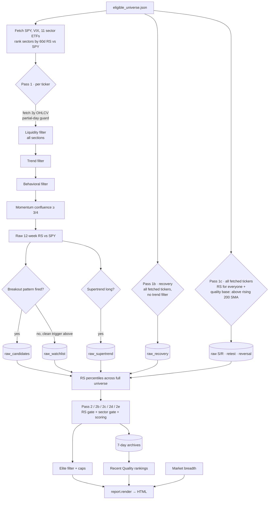

# Architecture

How the Breakout Swing Tool is put together: what runs, in what order, where state
lives, and where to change things. For setup and day-to-day use see `README.md`;
for the quarterly universe refresh see `SCREENING.md`.

---

## 1. Purpose and design principles

A daily, fully automated screen of a hand-curated US equity universe that surfaces a
small number of high-confluence swing-trade candidates (trend + momentum + volume +
relative strength + sector tailwind), published as a static HTML report.

| Principle | What it means in practice |
|---|---|
| Zero cost | GitHub Actions + GitHub Pages + `yfinance`. No paid APIs, no secrets. |
| Standalone | Independent of the weekly Positional Trading Tool. Shares only the Supertrend parameters (ATR 10 × 2.5) so both read the same signal. |
| Manual universe, automated scan | You curate ~500 tickers quarterly; the machine does everything daily. |
| Curated output | Strict "elite" filter and hard caps keep each daily section to 5–8 names. Everything that passes base gates is still archived. |
| State in git | All persistent state is committed JSON. No database. Daily commits also keep the workflow from being auto-disabled for inactivity. |
| Tunable in one place | Every threshold is a named constant at the top of `daily_scan.py`. |

---

## 2. Repository layout

```
breakout-swing-tool/
├── .github/workflows/daily-scan.yml   CI schedule and steps
├── input/manual_universe.csv          Your quarterly screen export (Ticker + Sector)
├── build_universe.py                  CSV → eligible_universe.json
├── daily_scan.py                      Orchestrator: fetch, filter, score, archive, render
├── patterns.py                        Pure indicator / pattern functions (no I/O)
├── report.py                          Pure HTML rendering (no I/O except write helpers)
├── eligible_universe.json             Generated each run from the CSV (committed)
├── data/                              Persistent state (committed by CI)
│   ├── report_history.json            Per-ticker appearance dates (14 d) + breadth history
│   ├── signals_archive.json           Breakout signals, rolling 7 d
│   ├── watchlist_archive.json         Watchlist entries, rolling 7 d
│   ├── supertrend_archive.json        Supertrend-long entries, rolling 7 d
│   ├── recovery_archive.json          Recovery entries, rolling 7 d
│   ├── setups_archive.json            S/R, retest, holding, reversal, MTF RSI, positional; rolling 7 d
│   ├── fundamentals_cache.json        Yahoo fundamentals per ticker, refreshed weekly
│   ├── trade_log.json                 Every recommendation's plan + tracked outcome, 45 d
│   └── earnings_cache.json            Next earnings date for Action Plan candidates (3-day cache)
├── reports/YYYY-MM-DD.html            One report per run (committed)
├── index.html                         Copy of the latest report (GitHub Pages landing)
├── requirements.txt                   pandas, numpy, requests, yfinance==0.2.65
├── README.md / SCREENING.md / ARCHITECTURE.md
```

**Module boundaries.** `patterns.py` and `report.py` are pure: they take DataFrames or
dicts and return values or HTML strings. All network access, file I/O, gating and
scoring policy live in `daily_scan.py`. Keep it that way: it makes indicators and
rendering testable without network access.

---

## 3. Runtime: the daily workflow

`.github/workflows/daily-scan.yml`, cron `0 22 * * 1-5` (22:00 UTC, Mon–Fri, after the
US close in both EST and EDT), plus manual `workflow_dispatch`. Timeout 30 min.

1. Checkout, set up Python 3.11, `pip install -r requirements.txt`
2. Fail fast if `input/manual_universe.csv` is missing
3. `python build_universe.py` → `eligible_universe.json`
4. `python daily_scan.py` → `reports/<date>.html`, updated `data/*.json`
5. Copy the newest `reports/*.html` to `index.html` (this overwrites the dashboard
   index that `daily_scan.py` also writes; the copy is what Pages serves)
6. Commit `eligible_universe.json reports/ data/ index.html` and push

Required repo settings: Actions → Workflow permissions → Read and write. Pages →
deploy from `main`, folder `/ (root)`.

---

## 4. Universe build (`build_universe.py`)

Reads the CSV with case-insensitive column aliases:

| Field | Accepted headers | Required |
|---|---|---|
| Ticker | `Ticker`, `Symbol` | Yes |
| Sector | `Sector`, `GICS Sector` | Strongly recommended |
| Name | `Name`, `Company`, `Company Name`, `Security Name` | No |

Normalises `BRK.B` → `BRK-B`, de-duplicates, drops malformed tickers, writes
`{"refreshed_at", "eligible": [{ticker, name, sector, piotroski_f_score}]}`.

**Sector matters.** Sector labels are mapped to SPDR ETFs via `SECTOR_TO_ETF` in
`daily_scan.py`. A ticker whose sector is missing or unmappable is never sector-gated
(rank `None` passes every sector check). If fewer than half the universe maps, the
scan logs `WARNING: only X/N tickers have a mappable sector`.

---

## 5. Scan pipeline (`daily_scan.py::main`)



### 5.1 Data fetch

`fetch_prices()` pulls 3 years of daily OHLCV per ticker (needed for monthly RSI)
with a 0.3 s delay. **Bad-bar repair:** up to 3 trailing bars with missing,
non-positive or impossible prices (close outside the high-low range) are dropped
(`_bad_bar()`), and the count is stored in `df.attrs["repaired_bars"]`. Yahoo
occasionally returns such a row outside market hours; left in, it makes every
"close vs moving average" test fail and empties the whole report. **Partial-day
guard:** if the last bar's volume is under 30% of the prior 20-day average, the bar is
dropped as an incomplete session (protects manual runs during market hours). Fetched
frames are cached in `price_cache` and reused by Pass 1b, Pass 1c and breadth.

**Data-health check.** Right after Pass 1, `assess_fetch_health()` compares what
was downloaded against the universe, using SPY's latest bar as the reference date.
After breadth is computed, `assess_breadth_plausibility()` checks for internally
contradictory readings. Either can call `abort_unhealthy()`, which logs the reasons
and exits with code 1: the workflow then skips publish and commit, so the previous
report stays live and no state changes.

| Level | Condition | Effect |
|---|---|---|
| Fail | < 80% downloaded; > 40% of tickers behind SPY's latest bar; breadth contradictory (≥ 50 tickers): 0% above both averages, or new highs dominating with < 10% above the 50-day, or new lows dominating with > 90% above it | Stop, publish nothing |
| Warn | 80–95% downloaded; > 10% a session behind; > 10% needed a bar repaired | Publish with amber banner |
| OK | otherwise | Publish; green data line |

Every report shows a data line (downloaded, latest market bar, stale, repaired,
symbols with no data).

**Liquidity levels.** `liquidity_profile()` stores, for every fetched ticker, a tier
(Very high ≥ $100M/day, High ≥ $25M, Adequate ≥ $10M), average shares/day, average
dollar volume and 1% of ADV. Before rendering, these are attached to every displayed
row (including weekly lists) and shown under the ticker.

**Liquidity filter (every section).** Right after fetching, `passes_liquidity()`
requires price ≥ $10, 20-session average volume ≥ 500K shares and average dollar
volume ≥ $10M. Failing tickers go into an `illiquid` set that Pass 1b and Pass 1c
also skip. Breadth still uses them, so breadth reflects the whole universe.

### 5.2 Pass 1: shared pre-filters (breakouts, watchlist, Supertrend)

| Gate | Rule | Constants |
|---|---|---|
| Trend | Close > SMA50 and > SMA200; SMA200 rising over 20 bars; within 25% of 52W high | `TREND_*` |
| Behavioral | No overnight gap-down worse than −10% in last 20 sessions | `BEHAVIORAL_MAX_GAP_DOWN_PCT` |
| Momentum | ≥ 3 of 4: RSI(14) 50–75; ADX(14) ≥ 20; weekly MACD(12,26,9) histogram > 0; 52W range position ≥ 60% | `MOMENTUM_*` |

Survivors get a raw RS value, then branch. **The branches are not exclusive**: a
ticker can land in Supertrend and in either breakouts or watchlist. Multi-section
appearances are intended confluence.

- **Breakout**: `patterns.scan_all_patterns()` fires any of 20/55/252-session high,
  horizontal resistance break, or volatility-contraction break (each with volume
  confirmation).
- **Watchlist**: no pattern fired, and `compute_watchlist_setup()` finds a pending
  trigger above price (20-day high, falling back to 55-day). Tickers already above
  both are skipped.
- **Supertrend**: `patterns.supertrend_state()` (ATR 10 × 2.5, Wilder ATR,
  TradingView band-carry logic) reports direction = long.

### 5.3 Pass 1b: Recovery (separate population)

Recovery candidates have just come out of a correction, so they usually fail the
"within 25% of 52W high" trend rule. Pass 1b therefore re-scans **every fetched
ticker**, skipping the trend filter:

1. Behavioral filter
2. `patterns.golden_cross_recovery()`: 20 EMA above 200 EMA, gap ≤ 10%, crossover
   from below within the last 30 bars, 20 EMA higher than 5 bars ago
3. Close above both EMAs and daily RSI ≥ 50. (The original 3-of-4 momentum gate
   is kept behind `RECOVERY_STRICT_MOMENTUM = True`; it was dropped by default
   because weekly MACD and 52-week range position lag a fresh cross.)

### 5.3b Pass 1c: full-universe RS and the S/R, retest and reversal setups

Pass 1c first computes raw 12-week RS for **every** fetched ticker, so percentiles
rank against the whole universe. (Before this, only trend-filter survivors were
ranked, which made "RS ≥ 75" mean the top quarter of the strongest quarter.)

It then applies a shared **quality base** (behavioral filter, close above a 200 SMA
that is higher than 20 sessions ago) and collects three setup types:

- **Support / resistance**: `patterns.nearest_support_resistance()` clusters swing
  highs and lows (5 bars each side, last 120 sessions, 1.5% clustering, ≥ 2 touches)
  and keeps tickers within 3% of the nearest level above or below.
- **Recent breakout**: `patterns.recent_breakout_status()` finds a close above the
  prior 55-session high on ≥ 1.5× volume 1–20 sessions ago, then classifies it as
  `retest` (pulled back ≥ 3%, recent low within 2% of the level, still holding) or
  `holding`. Breakouts closing > 3% back below the level are dropped as failed.
- **Reversal swing**: `patterns.reversal_swing_setup()` requires a 5–25% pullback
  from the 20-day high, RSI(14) ≤ 40 within 5 sessions, and a bullish engulfing,
  outside-reversal or hammer candle today.
- **Multi-timeframe RSI**: `patterns.mtf_rsi_bounce()` requires monthly and weekly
  RSI(14) ≥ 60 and a daily RSI cross from below 50 within 3 sessions, with cross-day
  volume ≥ 1.0× average. Checked after the behavioral filter, before the 200 SMA
  quality base.

**EMA crossovers** (detected with `patterns.ema_cross_up()`; the cross bar's close
is the signal price, and levels use only data up to the cross bar):

- **20/50 EMA, no gates**: any liquid ticker whose 20 EMA crossed above its 50 EMA in
  the last 5 sessions. Detected before every other Pass 1c check.
  `plan_ema2050_trade()`: stop = 10-day swing low − 1%, never more than 2.5 × ATR
  below entry; TP1 2R, TP2 3R; exit on a daily close below the 50 EMA. Ranked
  freshest first.
- **20/200 EMA golden cross (positional)**: cross in the last 10 sessions, close
  above both EMAs, 20 EMA rising, RSI > 50, behavioral filter, then (Pass 2g) RS ≥ 40
  and `fundamental_quality_value()`, i.e. the Positional quality and fair-value gates
  without its extension gates. Golden-cross tickers are fetched first in the
  fundamentals refresh. `plan_golden_cross_trade()`: stop = higher of (200 EMA at the
  cross − 3%) and (20-day low − 1%); TP1 2R; TP2 = larger of 3R and the prior 52-week
  high; exit on a weekly close below the 200 EMA.

**Trade plans and the trade log (every section).** After the elite filter,
`plan_trade()` gives every displayed recommendation an order type, entry, SL, TP1 and
TP2 (sections with their own levels keep them; watchlist and near-resistance become
pending buy-stops, holding-above a pending buy-limit; see the Methodology table).
`update_trade_log()` records each once in `trade_log.json` (key: strategy, ticker,
signal date; skipped while an earlier trade for the same strategy+ticker is still
active), keeps 45 days, and every run re-evaluates all trades with
`patterns.evaluate_trade_outcome()`: pending orders fill when price reaches the entry
or expire after 10 sessions; after the fill, stop before TP1 = Stopped (stop checked
first on a bar touching both), TP1 = TP1 hit (half banked, runner continues), TP2 =
TP2 hit. `result_pct` is the plan's outcome. `trade_scoreboard()` aggregates per block
(`CATEGORY_STRATEGIES`) and per strategy. Each displayed and weekly-list row carries
its latest trade (`r["trade"]`) for the status chip. The older crossover-only log is
migrated automatically on first load. Crossover signals already Stopped are removed
from today's lists.

**Fake breakouts.** `recent_breakout_status()` now returns `failed` / `failing`
statuses instead of dropping them, plus `fake_flags` (weak breakout close, marginal
volume, no follow-through, heavy selling since, back below level) and
`resistance_touches` (swing highs at the level before the break).
`todays_breakout_risk()` flags same-day breakouts (weak close, marginal volume,
extended > 5%, gap-and-fade); an Adverse regime adds a flag after breadth is known.
Retest and holding rows lose 5 points per flag.

**Positional candidates.** Every quality-base member is also recorded with its
extension metrics (% above 200 SMA and 50 SMA, daily and weekly RSI). After Pass 1c,
`refresh_fundamentals()` fetches missing or stale entries (> 7 days; failed lookups
retry after 3 days) via `yf.Ticker(t).info`, at most 120 per run, into
`fundamentals_cache.json`. Pass 2f runs `evaluate_positional()`: hard gates for
financial quality (ROE ≥ 10%, positive margin and FCF, D/E ≤ 2×), fair valuation
(PEG ≤ 2, or forward P/E ≤ 30 without PEG) and not overextended (0–15% above the 200
SMA, ≤ 8% above the 50 SMA, RSI ≤ 65, weekly RSI ≤ 70), then scores quality (≤ 50),
valuation (≤ 30), extension (≤ 20), RS ÷ 5 and sector.

**High-probability retest** = retest + bounce today + resistance_touches ≥ 2 +
zero fake flags. It gets +15 score and a gold ★ row, both in its own subsection and
in Near Support when the support level matches the broken resistance.

### 5.4 Confluence gates and scoring (Pass 2, 2b, 2c, 2d, 2e)

RS percentiles are computed once, across the full universe (see Pass 1c).

| Pipeline | RS gate | Sector gate | Score function | Max ≈ |
|---|---|---|---|---|
| Breakouts | ≥ 75 | rank ≤ 6 | `compute_score` | 180 |
| Watchlist | ≥ 75 | rank ≤ 6 | `compute_watchlist_score` | 112 |
| Supertrend | ≥ 75 | rank ≤ 6 | `compute_supertrend_score` | 122 |
| Recovery | ≥ 60 | rank ≤ 7 | `compute_recovery_score` | 142 |
| Near support | ≥ 60 | rank ≤ 6 | `compute_support_score` | 122 |
| Near resistance | ≥ 70 | rank ≤ 6 | `compute_resistance_score` | 142 |
| Break & retest / holding | ≥ 70 | rank ≤ 6 | `compute_retest_score` | 132 |
| Reversal swing | ≥ 55 | rank ≤ 7 | `compute_reversal_score` | 147 |
| Fake / failed breakouts | ≥ 60 | none | most recent first | — |
| MTF RSI momentum | ≥ 60 | rank ≤ 7 | `compute_mtf_rsi_score` | 147 |
| Positional | ≥ 40 | none | `evaluate_positional` + RS ÷ 5 + sector | 132 |
| Golden cross | ≥ 40 | none | quality + valuation + freshness (6–20) + RS ÷ 5 + sector | 132 |
| EMA 20/50 cross | none | none | 100 − 15 × cross age − gap (freshest first) | 100 |

Score components (see docstrings and the report's Methodology section for detail):

- **Breakout**: pattern base (10–30), volume bonus (≤ 15), base length (≤ 10), trend
  context (+10), streak (+5/day, ≤ 15), RS ≥ 90 (+10), sector top 3 (+5), 4/4
  momentum (+5). Piotroski component is unused in manual-CSV mode.
- **Watchlist**: RS ÷ 2, momentum × 5, sector strength (≤ 12), accumulation days × 2
  (≤ 20), top-quartile 52W position (+10).
- **Supertrend**: flip recency (30/25/15/5 by age band), RS ÷ 2, momentum × 5, sector
  (≤ 12), accumulation days (≤ 10).
- **Recovery**: crossover freshness (30/25/15/5), EMA closeness (20/15/10/5), RS ÷ 2,
  momentum × 5, sector (≤ 12), accumulation days (≤ 10).

**Levels.** Breakouts: stop = tighter of breakout × 0.93 or 20-day swing low; TP1 = 2R,
TP2 = 3R. Watchlist: same math from the pending trigger. Supertrend: the trailing
Supertrend line is the stop. Recovery: reference EMAs only (no computed levels).

### 5.5 Market regime

`compute_market_breadth()` averages five 0–10 sub-scores into a weekly score: % above
200 SMA, % above 50 SMA, new 52W highs vs lows, SPY 14-day ROC, VIX (inverted). The
monthly score is the mean of the last 20 stored weekly scores (`_breadth` key in
`report_history.json`). Weekly score < 4.0 (Adverse) raises the breakout display bar
from 40 to 75. The report colour-codes each sub-score (green ≥ 7, amber 4–7, red < 4)
with a one-line interpretation.

### 5.6 Display curation

Applied only to the four "Today's" sections. Archives are unaffected.

| Section | Criteria | Cap |
|---|---|---|
| Breakouts | score ≥ regime bar, RS ≥ 85, momentum 4/4, sector ≤ 4 | 5 |
| Watchlist | score ≥ 60, RS ≥ 85, momentum 4/4, sector ≤ 4, accumulation days ≥ 5 | 8 |
| Supertrend | score ≥ 60, RS ≥ 85, momentum 4/4, sector ≤ 4, **flip age ≤ 20 d** | 6 |
| Recovery | score ≥ 55 (gates already looser upstream) | 6 |
| Near Support / Near Resistance | score ≥ 60 | 10 each |
| Break & Retest / Holding Above | score ≥ 60 | 8 each |
| Reversal Swing | score ≥ 55 | 6 |
| ★ High-Probability Retests | subset of Break & Retest rows | (within 8) |
| Fake / Failed Breakouts | RS ≥ 60 | 8 |
| Multi-Timeframe RSI Momentum | score ≥ 60 | 8 |
| Positional | score ≥ 70 | 8 |
| Golden cross (inside Positional block) | score ≥ 60, not already stopped | 8 |
| EMA 20/50 cross | not already stopped | 25 (dashboard shows top 10) |

The S/R, retest, holding, reversal, MTF RSI and positional rows are archived in
`setups_archive.json` (all gated rows, not only displayed ones) and ranked by
`compute_recent_setups()` into each panel's weekly quality list.

"Sector ≤ 4" passes when sector rank is unknown (`sector_rank_ok()`).

---

## 6. Persistent state

| File | Written by | Retention | Used for |
|---|---|---|---|
| `report_history.json` | `update_history()` | 14 d | `days_on_report` streak bonus; `_breadth` monthly score |
| `signals_archive.json` | `update_signals_archive()` | 7 d | Recent Quality Breakouts |
| `watchlist_archive.json` | `update_watchlist_archive()` | 7 d | Recent Quality Watchlist |
| `supertrend_archive.json` | `update_supertrend_archive()` | 7 d | Recent Quality Supertrend |
| `recovery_archive.json` | `update_recovery_archive()` | 7 d | Recent Quality Recovery |
| `setups_archive.json` | `update_setups_archive()` | 7 d | Weekly lists for S/R, retest/holding, pullback, positional |
| `fundamentals_cache.json` | `refresh_fundamentals()` | refreshed per ticker every 7 d | Positional and golden cross |
| `trade_log.json` | `update_trade_log()` | 45 d (by signal date) | Plans, outcomes, scoreboards and signal logs for every block |

Each archive update drops entries older than `ARCHIVE_RETENTION_DAYS` and replaces any
same-day entries, so re-running a scan on the same date is idempotent. Missing files
are created on first run.

**Recent Quality ranking.** Per ticker, keep the peak-scoring day; require the peak to
clear the section's quality threshold (60 / 70 / 70 / 65); rank by
`keep_score = best_score + recency (+15 ≤ 7 d, +5 ≤ 21 d) + appearances × 2 (≤ 15) +
volume or accumulation bonus`; show top 10.

---

## 6b. Action Plan (the daily decision layer)

Built just before rendering by `build_action_plan()`; the only part of the report
needed for daily decisions.

**Your rules** (constants at the top of `daily_scan.py`): `TRADE_SIZE_USD = 500`,
`RISK_PER_TRADE_USD = 50`, `MAX_POSITIONS = 5`, `REGIME_MAX_POSITIONS` (Favorable 5,
Neutral 3, Adverse 1), `ALLOW_FRACTIONAL_SHARES = False`, `MAX_PER_SECTOR = 2`,
`MAX_CHASE_PCT = 3`, `MARKET_ENTRY_VALID_SESSIONS = 2`, `EARNINGS_LOOKAHEAD_DAYS = 14`.

**Ranking.** Every displayed recommendation with a plan becomes a candidate (fake
breakouts excluded; signals whose logged trade already Stopped, hit TP2 or Expired are
skipped; market and buy-stop ideas already > 3% past their entry are skipped).
Conviction = strength within its section (score ÷ `STRATEGY_MAX_SCORE`) ×
`STRATEGY_PRIOR` (1.0 for confirmed gated setups down to 0.6 for the ungated 20/50
cross) + up to 20 for multiple sections + 10 for ★ + liquidity (5/3) + track record
(±10 once a strategy has ≥ 15 resolved trades) + stop-distance adjustment. One
candidate per ticker (best section kept), max 2 per known sector.

**Sizing.** `size_position()`: shares = min($500 ÷ entry, $50 ÷ (entry − SL)), whole
shares unless fractional is enabled. With typical 3–8% stops the $500 cap binds, so
actual risk is often below $50.

**Warnings.** The top candidates (up to 20 lookups per run) get their next earnings
date from Yahoo's calendar (cached 3 days). Earnings within 14 days, or zero shares
affordable, make a candidate ineligible: it stays on the list as Bench with the reason.

**Output.** Up to 10 ranked candidates. The server labels the top `regime_cap` eligible
ones TAKE (as if you held nothing); the page's script relabels them using your stored
positions (Held / TAKE / Bench, TAKE count = free slots).

**Private positions.** Positions are stored only in the browser's `localStorage`
(key `swingTool.positions.v1`), never in the repo or the published page.
`build_market_data()` embeds each ticker's latest close/high/low, SMA50/200, EMA20,
10-day low and Supertrend level as JSON; the script computes per position: EXIT (low
≤ stop), TP2 reached, TP1 reached (sell half, stop to entry), Raise stop (only once
≥ 1R in profit or TP1 taken; to the higher of the Supertrend line and 10-day low − 1%,
never lower), else Hold. Buttons: I took this, TP1 taken, Edit SL, Apply, Close;
backup/restore via copy-paste text. Same origin across daily reports, so positions
persist day to day in the same browser.

The 8 strategy blocks are unchanged and sit in an **expanded** "All sections in detail" area below the plan
(collapsible with one click). Each idea's setup name links to its strategy block.

---

## 7. Report (`report.py`)

`render()` builds one self-contained HTML dashboard (embedded CSS, no scripts, no
external assets):

1. Masthead and colour-coded breadth panel
2. **At a glance**: one card per category (colour, today count, week count, top
   tickers); cards link to their block
3. **Multi-section chips and legend**: tickers appearing in 2+ sections today, plus
   the colour key
4. **One block per category**, each in its own colour (`PANEL_COLORS`), laid out in
   three columns: *What it is / How to use it* (`CATEGORY_GUIDE`), **Today** (compact
   list: ticker, setup, score, entry, stop, target) and **This week's quality list**
   (compact: ticker, setup, best score, times seen, pick date, level). The original
   wide tables, with full liquidity levels, sit under a collapsible *Full detail
   tables* in each block.
5. Diagnostics and Methodology, collapsed

| Block | Colour | Today | This week |
|---|---|---|---|
| Breakouts | blue | breakouts | `signals_archive` |
| Pre-breakout watch | teal | watchlist, near resistance | `watchlist_archive`, setups: resistance |
| Break & retest | gold | ★ retests, retests, holding (+ avoid line for fakes) | setups: retest, holding |
| Trend following | purple | Supertrend flips | `supertrend_archive` |
| Pullback & reversal | green | near support, reversal, MTF RSI | setups: support, reversal, mtf_rsi |
| Recovery | orange | recovery | `recovery_archive` |
| Positional | navy | quality at a fair price, golden crosses | setups: positional + golden-cross log & scoreboard |
| EMA 20/50 crossover | olive | 20/50 crosses (no gates) | 20/50 signal log & scoreboard (45 d) |

**Multi-section highlighting.** `render()` maps each ticker to the set of today
sections it appears in (11 sections; Fake/failed and the ★ subset are excluded).
Every row for that ticker, in compact lists, weekly lists and full tables, gets a
badge (`_cf_badge`), and CSS `tr:has(.cf2)` / `tr:has(.cf3)` colours the row: violet
for 2 sections, pink for 3+. ★ high-probability rows keep a gold left stripe.

**Trade tracking in the report.** Every ticker cell goes through `_tk()`, which adds
the multi-section badge, the trade status chip (`_trade_chip`: New, Open ±x%, ✓ TP1,
✓ TP2, ✗ SL, Pending, Expired; hover for the logged levels), the plan line
(`_plan_line`, full tables) and the liquidity line. Each block's right column starts
with its scoreboard; its Full detail ends with per-strategy scoreboards and the
block's complete signal log (`_render_signal_log_table`).

Compact lists take entry/SL/TP from `r["plan"]`; `_TODAY_FIELDS` supplies the setup
label and `_WEEK_FIELDS` the weekly level. Adding a section means: a full table
renderer, a `render()` keyword argument, a `plan_trade()` rule, entries in
`_TODAY_FIELDS`, `CATEGORY_STRATEGIES` / `CAT_STRATS` and `_STRAT_LABELS`, adding it to
the right `cats` block, `section_rows` and `today_lists`, funnel rows, and a
methodology block.

---

## 8. Configuration

All knobs are module-level constants at the top of `daily_scan.py`, grouped by
pipeline. The ones you are most likely to touch:

| Constant | Default | Effect |
|---|---|---|
| `MAX_*_SHOWN` | 5 / 8 / 6 / 6 | Rows per Today's section |
| `ELITE_RS_PERCENTILE_MIN` | 85 | Elite RS bar |
| `ELITE_MOMENTUM_PASSES_MIN` | 4 | Elite momentum bar (3 is the main loosening lever) |
| `ELITE_SECTOR_RANK_MAX` | 4 | Elite sector bar |
| `SUPERTREND_MAX_FLIP_AGE_DAYS` | 20 | Freshness of displayed flips |
| `RECOVERY_MAX_DISTANCE_PCT` | 10.0 | Max 20/200 EMA gap |
| `RS_PERCENTILE_MIN` / `SECTOR_MAX_RANK` | 75 / 6 | Base gates (affect archives too) |
| `ARCHIVE_RETENTION_DAYS` | 7 | History window |
| `SUPERTREND_ATR_PERIOD` / `_MULTIPLIER` | 10 / 2.5 | Keep in sync with the Positional Trading Tool |
| `SR_NEAR_PCT` / `SR_MIN_TOUCHES` | 3.0 / 2 | How close counts as "near", and level strength |
| `RETEST_MAX_AGE_BARS` / `RETEST_BAND_PCT` | 20 / 2.0 | Breakout lookback and retest tolerance |
| `REVERSAL_RSI_OVERSOLD` | 40 | How oversold the pullback must get |
| `patterns.VOLUME_MULTIPLE_THRESHOLD` | 1.5 | Volume confirmation for every breakout detector |
| `MIN_PRICE` / `MIN_AVG_VOLUME` / `MIN_AVG_DOLLAR_VOLUME` | 10 / 500K / 10M | Liquidity filter for all sections |
| `HP_MIN_RESISTANCE_TOUCHES` / `FAKE_FLAG_PENALTY` | 2 / 5 | High-probability rule and fakeout penalty |
| `MTF_RSI_MONTHLY_MIN` / `_WEEKLY_MIN` / `_DAILY_LEVEL` | 60 / 60 / 50 | Multi-timeframe RSI thresholds |
| `PRICE_HISTORY_PERIOD` | "3y" | Must stay ≥ 2y for monthly RSI |
| `LIQUIDITY_TIERS` | 100M / 25M / 10M | Tier labels on the liquidity line |
| `POS_MAX_PEG` / `POS_MAX_PCT_ABOVE_200SMA` / `POS_MAX_DAILY_RSI` | 2.0 / 15 / 65 | Positional valuation and extension limits |
| `FUNDAMENTALS_MAX_REFRESH_PER_RUN` | 120 | Yahoo lookups per run (runtime vs cache fill speed) |
| `GC_MAX_CROSS_AGE` / `EMA2050_MAX_CROSS_AGE` | 10 / 5 | How recent a cross must be to show |
| `CROSSOVER_LOG_RETENTION_DAYS` | 45 | How long trades and outcomes are kept (all sections) |
| `PENDING_EXPIRY_SESSIONS` | 10 | Unfilled buy-stop / buy-limit orders expire after this |
| `RECOVERY_STRICT_MOMENTUM` | False | True restores Recovery's original 3-of-4 momentum gate |
| `HEALTH_FAIL_FETCH_RATE` / `HEALTH_FAIL_STALE_SHARE` | 0.80 / 0.40 | When a run refuses to publish |
| `HEALTH_WARN_*` | 0.95 / 0.10 / 0.10 | When the amber partial-data banner appears |
| `TRADE_SIZE_USD` / `RISK_PER_TRADE_USD` | 500 / 50 | Position size cap and max loss per trade |
| `MAX_POSITIONS` / `REGIME_MAX_POSITIONS` | 5 / 5-3-1 | Open-position limits overall and by market regime |
| `ALLOW_FRACTIONAL_SHARES` | False | True if your broker buys fractional US shares |
| `STRATEGY_PRIOR` | 1.0 … 0.6 | How much each section counts in the Action Plan before its own track record |

When a section is empty, read the funnel before tuning: it shows whether candidates
died at pattern detection, a base gate, or the elite filter.

---

## 9. Testing

There is no unit-test suite yet. Two checks are used before every release:

1. **Parse check**: `python -c "import ast; [ast.parse(open(f).read()) for f in
   ['build_universe.py','patterns.py','report.py','daily_scan.py']]"`
2. **Offline end-to-end run**: monkeypatch `daily_scan.fetch_prices` and
   `fetch_sector_etfs` to return synthetic OHLCV, then call `daily_scan.main()` in a
   scratch copy of the repo. Run it twice: once with a sector-less universe, once with
   sectors, and once with `BREADTH_ADVERSE_THRESHOLD` forced high to exercise the
   Adverse path. Rendering-only tests are not sufficient; they missed runtime errors
   in `main()` in the past. Synthetic prices must use a **timezone-aware
   `America/New_York` index**, exactly as yfinance returns it: tz-naive test data
   once hid a date-comparison crash in the crossover outcome replay.

---

## 10. Known limitations and technical debt

- **Sector depends on the CSV.** No sector lookup happens at scan time. A CSV without
  a Sector column turns all sector logic off (with a log warning).
- **`yfinance` is unofficial.** Pinned to 0.2.65; breakages show up as `no_data` in
  the funnel.
- **Earnings proximity check is disabled** (`ENABLE_EARNINGS_CHECK = False`): no
  reliable free source. Check earnings dates manually before entering.
- **Piotroski** is carried through the data model and report but is always blank in
  manual-CSV mode.
- **Duplicate helpers in `patterns.py`.** `rsi()` and `adx()` are defined twice; the
  later definitions win at import. `patterns.check_momentum_confluence()` (RSI band
  50–70) is unused; the live momentum gate is `daily_scan.passes_momentum_confluence()`
  (RSI 50–75). Safe to delete the earlier duplicates and the unused function in a
  cleanup pass.
- **Recovery has no computed stop/targets**, only EMA reference levels.
- **Monthly RSI uses the in-progress month** (as TradingView does) and 3 years of
  history, so early-month values can move and may differ from charting tools by a
  few points.
- **Fundamentals depend on Yahoo's unofficial `info` endpoint.** It is slow (one call
  per ticker) and occasionally fails or rate-limits; the cache and per-run cap contain
  this, but a Yahoo outage simply leaves the Positional panel thin. Figures can be
  stale or restated: verify in filings.
- **A failed health check means no report that day.** That is deliberate (no report
  beats a misleading one); re-run from the Actions tab once Yahoo recovers. GitHub
  emails the repo owner on failed workflow runs by default.
- **Positions live in one browser.** They don't sync between devices; use the backup
  text to move them. Clearing browser data deletes them.
- **Earnings dates are best-effort.** Yahoo's free calendar can be missing or wrong;
  a missing date is not a guarantee there is no report.
- **Tracked results are idealised.** Fills are assumed exactly at the planned price
  (no slippage; a gap through a buy-stop still fills at the trigger) and there are no
  costs. Treat the scoreboards as a comparison between sections, not exact P&L.
- **Outcome tracking uses daily bars only.** If one bar touches both the stop and a
  target, the stop is assumed to have come first. After TP1 the remaining position is
  treated as a runner and the stop is no longer counted, so "TP1 hit" can include
  trades that later fell back.
- **Positional fills gradually.** With ~250 quality-base names and a 120-per-run cap,
  the cache is complete after about three runs.
- **Tight elite Supertrend combination.** A fresh flip after a pullback often still
  has a negative weekly MACD, so "flip ≤ 20 d" plus "momentum 4/4" can leave the
  section empty in otherwise healthy markets. Loosen `ELITE_MOMENTUM_PASSES_MIN` first
  if this happens persistently.
